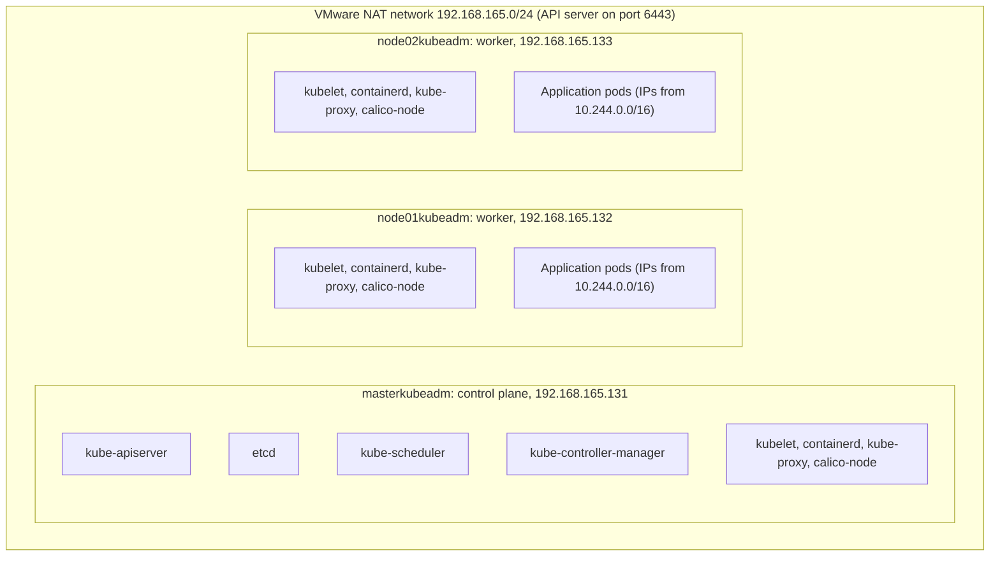

# Kubernetes Cluster Deployment with kubeadm

Last updated: 2026-11-20

## Summary

I built a three-node Kubernetes 1.35 cluster by hand (one control plane, two workers) with kubeadm on Ubuntu Server 24.04, with no automation tooling, to understand what each component does and why it is there. The cluster is operational: three nodes `Ready`, system pods `Running`, pod networking provided by Calico.

| Item           | Detail                                                                               |
| Goal           | Master cluster bootstrap, from a bare VM to a working cluster                        |
| Stack          | kubeadm, kubelet, containerd 2.4, Calico 3.33 (Tigera Operator), Ubuntu Server 24.04 |
| Infrastructure | 3 VMs on VMware Workstation Pro (1 control plane, 2 workers), NAT network            |
| Target version | Kubernetes 1.35, chosen so I can practise the upgrade to 1.37 myself                 |
| Deliverable    | Reproducible procedure, justified decisions, diagnosed incidents                     |

## Context and goals

After following *Kubernetes the Hard Way*, I wanted to understand what kubeadm automates, rather than reuse the Vagrant provisioning from an online course. So I installed each VM by hand, one at a time, checking every step.

Project goals:

- Understand what `kubeadm init` produces: CA, certificates, kubeconfigs, control plane static pods, add-ons.
- Produce a reproducible procedure, with a check after every step.
- Justify each technical choice (runtime, CNI, address ranges, version).
- Have a 1.35 cluster on which to practise the upgrade to 1.37, then troubleshooting.

## Architecture

The cluster has one control plane node and two workers, all on a single VMware NAT network. The control plane also hosts etcd as a static pod.



The control plane runs the four control plane components as static pods; every node runs the same agents (kubelet, containerd, kube-proxy, calico-node).

| Node | Role | IP address | RAM | Disk |
| --- | --- | --- | --- | --- |
| `masterkubeadm` | Control plane (API server, controller manager, scheduler, etcd) | 192.168.165.131 | 3 GB | 40 GB |
| `node01kubeadm` | Worker | 192.168.165.132 | 1.5 GB | 30 GB |
| `node02kubeadm` | Worker | 192.168.165.133 | 1.5 GB | 30 GB |

Three address ranges must not overlap. Calico's default pod range (`192.168.0.0/16`) would have collided with the VM network, so I changed it.

| Network | Range | Notes |
| --- | --- | --- |
| Nodes (VMware NAT) | 192.168.165.0/24 | API server on port 6443 |
| Pods | 10.244.0.0/16 | Set in kubeadm (`podSubnet`) and in Calico's IP pool |
| Services | 10.96.0.0/12 | kubeadm default, no conflict |

| Component | Version |
| --- | --- |
| Ubuntu Server | 24.04.3 LTS |
| Kubernetes (kubeadm, kubelet, kubectl) | 1.35, versions held with `apt-mark hold` |
| containerd | 2.x, from the Docker apt repository |
| Calico | 3.33.0, installed with the Tigera Operator |

## Technical decisions

Each choice below was made on purpose, with the reason recorded so the setup can be defended or changed later.

| Decision | Choice | Alternative | Reason |
| --- | --- | --- | --- |
| Kubernetes version | 1.35 | Latest release | Leaves room to practise the upgrade to 1.37 myself, one minor version at a time (1.35 → 1.36 → 1.37) |
| Container runtime | containerd 2.x from the Docker apt repository | containerd 1.7 from Ubuntu's repository | Kubernetes 1.36 and later need containerd 2.x, so installing it now avoids migrating mid-upgrade |
| cgroup driver | `systemd` in both kubelet and containerd | `cgroupfs` | Both must use the same driver, and systemd is the init system on Ubuntu |
| CNI | Calico, installed with the Tigera Operator | Flannel, Cilium | Supports NetworkPolicy, operator manages the lifecycle, and 3.33 is tested against Kubernetes 1.35 to 1.37 |
| Pod CIDR | 10.244.0.0/16 | Calico default 192.168.0.0/16 | The default overlaps the VM network 192.168.165.0/24 |
| Cluster bootstrap | `kubeadm init --config` with a YAML file | Long command-line flags | Every parameter is visible, reviewable and can be versioned |
| Package versions | `apt-mark hold` on kubelet, kubeadm, kubectl | Unpinned packages | A routine `apt upgrade` cannot change the cluster version by accident |
| Swap | Disabled permanently (`/etc/fstab`) | Leave enabled | The kubelet refuses to start with swap by default |

## Step-by-step deployment

Steps 1 to 7 are done on every node. Steps 8 and 9 run on the control plane only, step 10 on the workers, and step 11 on the control plane again. Each step ends with a check, because a mistake caught early is cheaper than one found during `kubeadm init`.

### 1. Check that each node is unique

Kubernetes needs a unique hostname, MAC address and `product_uuid` per node.

```bash
hostnamectl --static
ip -br link
sudo cat /sys/class/dmi/id/product_uuid
```

Check: the three values differ on all three VMs.

### 2. Stable addresses and name resolution

The API server address is written into the certificates, so a node IP must not change. After fixing the IPs, I mapped the three names in `/etc/hosts` and commented out the `127.0.1.1` line so that each hostname resolves to its real address.

```bash
prasolonjatovo@node01kubeadm:~$ sudo sed -i 's/^127\.0\.1\.1/#127.0.1.1/' /etc/hosts
cat <<EOF | sudo tee -a /etc/hosts
192.168.165.131 masterkubeadm
192.168.165.132 node01kubeadm
192.168.165.133 node02kubeadm
EOF

prasolonjatovo@node01kubeadm:~$ getent hosts masterkubeadm
192.168.165.131 masterkubeadm
```


### 3. Time synchronisation

Certificates depend on the clock. A node with a drifting clock produces confusing TLS errors.

```bash
prasolonjatovo@node01kubeadm:~$ timedatectl
System clock synchronized: yes
              NTP service: active
          RTC in local TZ: no
```

Checked: `System clock synchronized: yes` and `NTP service: active`.

### 4. Disable swap permanently

```bash
prasolonjatovo@node01kubeadm:~$ sudo swapoff -a
prasolonjatovo@node01kubeadm:~$ sudo sed -i '/\/swap.img/ s/^/#/' /etc/fstab
prasolonjatovo@node01kubeadm:~$ swapon --show
prasolonjatovo@node01kubeadm:~$ free -h
total        used        free      shared  buff/cache   available
Swap:             0B          0B          0B
```

### 5. Kernel modules and network settings

`overlay` is needed by the container runtime, `br_netfilter` lets iptables see bridged traffic, and `ip_forward` lets a node route packets between pods.

```bash
prasolonjatovo@node01kubeadm:~$ cat <<EOF | sudo tee /etc/modules-load.d/k8s.conf
overlay
br_netfilter
EOF

prasolonjatovo@node01kubeadm:~$ sudo cat /etc/modules-load.d/k8s.conf
overlay
br_netfilter

prasolonjatovo@node01kubeadm:~$ sudo modprobe overlay
prasolonjatovo@node01kubeadm:~$ sudo modprobe br_netfilter

prasolonjatovo@node01kubeadm:~$ cat <<EOF | sudo tee /etc/sysctl.d/k8s.conf
net.bridge.bridge-nf-call-iptables  = 1
net.bridge.bridge-nf-call-ip6tables = 1
net.ipv4.ip_forward                 = 1
EOF
prasolonjatovo@node01kubeadm:~$ sudo sysctl --system
```

### 6. Install containerd 2.x

I used the Docker apt repository because it ships containerd 2.x (see Technical decisions). The packaged `config.toml` disables the CRI plugin, so I regenerated the default configuration and switched the cgroup driver to systemd.

```bash
sudo apt update && sudo apt install -y ca-certificates curl gpg
sudo install -m 0755 -d /etc/apt/keyrings
sudo curl -fsSL https://download.docker.com/linux/ubuntu/gpg -o /etc/apt/keyrings/docker.asc
sudo chmod a+r /etc/apt/keyrings/docker.asc
echo "deb [arch=$(dpkg --print-architecture) signed-by=/etc/apt/keyrings/docker.asc] https://download.docker.com/linux/ubuntu $(. /etc/os-release && echo "$VERSION_CODENAME") stable" | sudo tee /etc/apt/sources.list.d/docker.list > /dev/null
sudo apt update && sudo apt install -y containerd.io

sudo mkdir -p /etc/containerd
containerd config default | sudo tee /etc/containerd/config.toml > /dev/null
sudo sed -i 's/SystemdCgroup = false/SystemdCgroup = true/' /etc/containerd/config.toml
sudo systemctl restart containerd && sudo systemctl enable containerd
```

Checked : 
```text
prasolonjatovo@node01kubeadm:~$ containerd --version
containerd containerd v2.4.2 b7a25261e029d68978bbf290df0a62fc819b3c51

prasolonjatovo@node01kubeadm:~$ grep SystemdCgroup /etc/containerd/config.toml
SystemdCgroup = true

prasolonjatovo@node01kubeadm:~$ systemctl is-active containerd
active
```

### 7. Install kubeadm, kubelet and kubectl

The Kubernetes apt repository is versioned per minor release, so the repository line has to change at each upgrade.

```bash
sudo apt-get install -y apt-transport-https ca-certificates curl gpg
curl -fsSL https://pkgs.k8s.io/core:/stable:/v1.35/deb/Release.key | sudo gpg --dearmor -o /etc/apt/keyrings/kubernetes-apt-keyring.gpg
echo 'deb [signed-by=/etc/apt/keyrings/kubernetes-apt-keyring.gpg] https://pkgs.k8s.io/core:/stable:/v1.35/deb/ /' | sudo tee /etc/apt/sources.list.d/kubernetes.list
sudo apt-get update
sudo apt-get install -y kubelet kubeadm kubectl
sudo apt-mark hold kubelet kubeadm kubectl
sudo systemctl enable --now kubelet
```

Checked:
```text
prasolonjatovo@node01kubeadm:~$ kubeadm version -o short
v1.35.10
```
At this step, the kubelet restarts in a loop until `kubeadm init` or `join` runs, which is expected.

### 8. Initialise the control plane

I used a configuration file rather than flags, so every parameter is explicit.

```yaml
apiVersion: kubeadm.k8s.io/v1beta4
kind: InitConfiguration
localAPIEndpoint:
  advertiseAddress: 192.168.165.131
  bindPort: 6443
nodeRegistration:
  name: masterkubeadm
  criSocket: unix:///run/containerd/containerd.sock
---
apiVersion: kubeadm.k8s.io/v1beta4
kind: ClusterConfiguration
kubernetesVersion: v1.35.10
networking:
  podSubnet: 10.244.0.0/16
  serviceSubnet: 10.96.0.0/12
  dnsDomain: cluster.local
---
apiVersion: kubelet.config.k8s.io/v1beta1
kind: KubeletConfiguration
cgroupDriver: systemd
```

```bash
kubeadm config validate --config ~/kubeadm-config.yaml
sudo kubeadm config images pull --config ~/kubeadm-config.yaml
sudo kubeadm init --config ~/kubeadm-config.yaml 2>&1 | tee ~/kubeadm-init.log
```

The init runs these phases: preflight checks, certificates under `/etc/kubernetes/pki`, kubeconfigs, static pod manifests for etcd and the control plane, bootstrap token, then the CoreDNS and kube-proxy add-ons.

### 9. Configure kubectl (control plane)

```bash
mkdir -p $HOME/.kube
sudo cp -i /etc/kubernetes/admin.conf $HOME/.kube/config
sudo chown $(id -u):$(id -g) $HOME/.kube/config

```

Checked: 
```text
prasolonjatovo@masterkubeadm:~$ kubectl get nodes
NAME            STATUS   ROLES           AGE   VERSION
masterkubeadm   NotReady    control-plane   1d   v1.35.10

prasolonjatovo@masterkubeadm:~$ kubectl get pods -A
NAMESPACE         NAME                                       READY   STATUS    RESTARTS        AGE
kube-system       coredns-7d764666f9-576ct                   0/1     Pending   0               1d
kube-system       coredns-7d764666f9-h747n                   0/1     Pending   0               1d
kube-system       etcd-masterkubeadm                         1/1     Running   0               1d
```

CoreDNS pods are `Pending` until a CNI is installed.

### 10. Join the workers

On the control plane, during kubeadm innit  kubeadm token is created to join the cluster. The command was ran with `sudo` on each worker. The `--discovery-token-ca-cert-hash` argument lets the worker verify the control plane's CA, which protects it from joining an impostor.

```bash
prasolonjatovo@node01kubeadm:~$ kubeadm join 192.168.165.131:6443 --token 5jdf88.7t18cxx7dsuiomls \
        --discovery-token-ca-cert-hash sha256:e3ae7d1ecde5f55a595556586cc8461777ac019a088b39f157393e3c0c7213ae 
```

Checked:
```text
prasolonjatovo@masterkubeadm:~$ kubectl get nodes
NAME            STATUS   ROLES           AGE   VERSION
masterkubeadm   NotReady    control-plane   1d   v1.35.10
node01kubeadm   NotReady    <none>          0d   v1.35.10
node02kubeadm   NotReady    <none>          0d   v1.35.10
```

### 11. Installation of the Calico CNI (control plane)

On Kubernetes 1.35, Calico 3.33 uses the `v1beta1` variant of its CRDs, which depend on the `MutatingAdmissionPolicy` API. That API was not served by default (`kubectl api-resources | grep -i mutatingadmissionpolicy` returned nothing), so I enabled it on the API server by adding two arguments to `/etc/kubernetes/manifests/kube-apiserver.yaml`. The kubelet recreates the static pod by itself.

```yaml
    - --feature-gates=MutatingAdmissionPolicy=true
    - --runtime-config=admissionregistration.k8s.io/v1beta1=true
```

Then the CRDs, the operator, and the custom resources with my pod range:

```bash
kubectl create -f https://raw.githubusercontent.com/projectcalico/calico/v3.33.0/manifests/v3_projectcalico_org-v1beta1.yaml
kubectl create -f https://raw.githubusercontent.com/projectcalico/calico/v3.33.0/manifests/tigera-operator.yaml
curl -O https://raw.githubusercontent.com/projectcalico/calico/v3.33.0/manifests/custom-resources.yaml
sed -i 's#cidr: 192.168.0.0/16#cidr: 10.244.0.0/16#' custom-resources.yaml
prasolonjatovo@masterkubeadm:~$ kubectl create -f custom-resources.yaml
prasolonjatovo@masterkubeadm:~$ watch kubectl get tigerastatus
```

I used `kubectl create` and not `apply` because the CRD bundle is too large for `apply`. Check: all Calico components report `AVAILABLE = True`, the three nodes become `Ready`, and the CoreDNS pods move to `Running`.

```text
prasolonjatovo@masterkubeadm:~$ kubectl get pods -A
NAMESPACE         NAME                                       READY   STATUS    RESTARTS        AGE
calico-system     goldmane-79cdd47974-9zgq8                  1/1     Running   0                0d
calico-system     whisker-6d984c7d59-m4wpt                   2/2     Running   0                0d
kube-system       coredns-7d764666f9-576ct                   1/1     Running   0                0d
kube-system       coredns-7d764666f9-h747n                   1/1     Running   0                0d
```

## Issues and how I resolved them

Four situations taught me the most. For each one I started from an observable symptom, found the cause with a command, and verified the fix.

| Situation | How I diagnosed it | Root cause | Resolution |
| --- | --- | --- | --- |
| Pre-check before installing Calico: the `MutatingAdmissionPolicy` API is missing | `kubectl api-versions` listed only `admissionregistration.k8s.io/v1`, and `kubectl api-resources` showed no `mutatingadmissionpolicies` | Calico 3.33's CRDs on Kubernetes 1.35 need an API that is beta and off by default | Enabled the feature gate and the `v1beta1` runtime config in the `kube-apiserver` static pod manifest, waited for the pod to restart, then re-ran the check |
| Calico's default pod range overlaps the VM network | Read the default `custom-resources.yaml` before applying it | Default pool `192.168.0.0/16` contains my node network `192.168.165.0/24` | Set the pool to `10.244.0.0/16`, the same value as kubeadm's `podSubnet` |
| After applying Calico, pods stuck in `ContainerCreating` or `Pending`, nodes `NotReady` | `kubectl describe pod` showed `NetworkPluginNotReady: cni plugin not initialized` | Expected start-up dependency: `calico-node` init containers must pull the image and write the CNI configuration before other pods get a network | Waited for the image pull, watched `kubectl get pods -n calico-system`, and confirmed the nodes turned `Ready` |
| Calico pods showing node addresses (192.168.165.x), which looked like an overlap | `kubectl get pods -o wide` and the pod description | `calico-node` and `calico-typha` run in the host network, so they show the node IP | No fault. I confirmed the pod range in the `Installation` resource, in `kubeadm-config`, and in each node's `spec.podCIDR` |

Two habits came out of this: read the release's requirements page before installing an add-on, and read the events at the bottom of `kubectl describe` before changing anything.

## Validation

The cluster is considered healthy when the checks below pass. They cover the control plane, the nodes, the CNI, pod-to-pod traffic across nodes, and DNS.

| Check | Command | Expected result |
| --- | --- | --- |
| Nodes | `kubectl get nodes -o wide` | 3 nodes `Ready`, version 1.35.x, container runtime containerd 2.x |
| System pods | `kubectl get pods -A -o wide` | All pods `Running`, CoreDNS pods with an IP in 10.244.0.0/16 |
| Calico | `kubectl get tigerastatus` | Every component `AVAILABLE = True` |
| Pod range | `kubectl get installation default -o jsonpath='{.spec.calicoNetwork.ipPools[*].cidr}'` | `10.244.0.0/16` |
| Cross-node traffic | Deploy 2 nginx replicas, then `wget` one pod IP from a `busybox` pod | The nginx welcome page is returned |
| DNS | `nslookup kubernetes.default` from a `busybox` pod | Resolves to the `kubernetes` service address (10.96.0.1) |

```bash
kubectl create deployment web --image=nginx --replicas=2
kubectl run test --rm -it --image=busybox:1.36 --restart=Never -- sh
# inside the pod: wget -qO- http://<web-pod-ip> ; nslookup kubernetes.default
kubectl delete deployment web
```

Deployment of my app on the cluster for real test, and it work correctly.
```bash
prasolonjatovo@masterkubeadm:~$ kubectl get nodes
NAME            STATUS   ROLES           AGE   VERSION
masterkubeadm   Ready    control-plane   1d   v1.35.10
node01kubeadm   Ready    <none>          1d   v1.35.10
node02kubeadm   Ready    <none>          1d   v1.35.10

# App deployment on th local cluster
prasolonjatovo@masterkubeadm:~$ kubectl get all -A -o wide
NAMESPACE         NAME                                           READY   STATUS    RESTARTS        AGE     IP                NODE            NOMINATED NODE   READINESS GATES
calico-system     pod/calico-kube-controllers-669ff8c685-lsnd5   1/1     Running   7 (19h ago)     11d     10.244.66.183     node02kubeadm   <none>           <none>
calico-system     pod/calico-node-2fgft                          1/1     Running   6 (19h ago)     11d     192.168.165.131   masterkubeadm   <none>           <none>
calico-system     pod/calico-node-9cjnv                          1/1     Running   6 (19h ago)     11d     192.168.165.132   node01kubeadm   <none>           <none>
calico-system     pod/calico-node-9j7sp                          1/1     Running   6 (19h ago)     11d     192.168.165.133   node02kubeadm   <none>           <none>
calico-system     pod/calico-typha-6cbfb78d84-8f4tf              1/1     Running   6 (19h ago)     11d     192.168.165.133   node02kubeadm   <none>           <none>
calico-system     pod/calico-typha-6cbfb78d84-r4jj4              1/1     Running   6 (19h ago)     11d     192.168.165.131   masterkubeadm   <none>           <none>
calico-system     pod/calico-webhooks-6b94c6898c-58stk           1/1     Running   6 (19h ago)     11d     10.244.66.186     node02kubeadm   <none>           <none>
calico-system     pod/calico-webhooks-6b94c6898c-64tlq           1/1     Running   6 (19h ago)     11d     10.244.66.181     node02kubeadm   <none>           <none>
calico-system     pod/csi-node-driver-k2npw                      2/2     Running   12 (19h ago)    11d     10.244.66.187     node02kubeadm   <none>           <none>
calico-system     pod/csi-node-driver-nthj8                      2/2     Running   12 (19h ago)    11d     10.244.168.135    masterkubeadm   <none>           <none>
calico-system     pod/csi-node-driver-p6xbd                      2/2     Running   12 (19h ago)    11d     10.244.197.210    node01kubeadm   <none>           <none>
calico-system     pod/goldmane-79cdd47974-9zgq8                  1/1     Running   6 (19h ago)     11d     10.244.66.182     node02kubeadm   <none>           <none>
calico-system     pod/whisker-6d984c7d59-m4wpt                   2/2     Running   12 (19h ago)    11d     10.244.66.189     node02kubeadm   <none>           <none>
demo1             pod/mysql-86b756bfbf-6q6fh                     1/1     Running   3 (154m ago)    2d20h   10.244.197.211    node01kubeadm   <none>           <none>
demo1             pod/nginx-747b9656b-djr7w                      1/1     Running   1 (19h ago)     2d19h   10.244.66.188     node02kubeadm   <none>           <none>
demo1             pod/vengineers-backend-5f5694f69-bc8x8         1/1     Running   1 (19h ago)     2d20h   10.244.197.208    node01kubeadm   <none>           <none>
demo1             pod/vengineers-frontend-7fcc9bddc7-gl55b       1/1     Running   1 (19h ago)     43h     10.244.197.209    node01kubeadm   <none>           <none>
kube-system       pod/coredns-7d764666f9-576ct                   1/1     Running   6 (19h ago)     11d     10.244.66.185     node02kubeadm   <none>           <none>
kube-system       pod/coredns-7d764666f9-h747n                   1/1     Running   6 (19h ago)     11d     10.244.66.184     node02kubeadm   <none>           <none>
kube-system       pod/etcd-masterkubeadm                         1/1     Running   6 (19h ago)     11d     192.168.165.131   masterkubeadm   <none>           <none>
kube-system       pod/kube-apiserver-masterkubeadm               1/1     Running   6 (19h ago)     11d     192.168.165.131   masterkubeadm   <none>           <none>
kube-system       pod/kube-controller-manager-masterkubeadm      1/1     Running   11 (161m ago)   11d     192.168.165.131   masterkubeadm   <none>           <none>
kube-system       pod/kube-proxy-2rpn5                           1/1     Running   6 (19h ago)     11d     192.168.165.133   node02kubeadm   <none>           <none>
kube-system       pod/kube-proxy-g5rqv                           1/1     Running   6 (19h ago)     11d     192.168.165.131   masterkubeadm   <none>           <none>
kube-system       pod/kube-proxy-jlh7v                           1/1     Running   6 (19h ago)     11d     192.168.165.132   node01kubeadm   <none>           <none>
kube-system       pod/kube-scheduler-masterkubeadm               1/1     Running   10 (154m ago)   11d     192.168.165.131   masterkubeadm   <none>           <none>
tigera-operator   pod/tigera-operator-665b58cc76-w9jhr           1/1     Running   19 (161m ago)   11d     192.168.165.132   node01kubeadm   <none>           <none>

NAMESPACE       NAME                                      TYPE        CLUSTER-IP       EXTERNAL-IP   PORT(S)                  AGE     SELECTOR
calico-system   service/calico-kube-controllers-metrics   ClusterIP   None             <none>        9094/TCP                 11d     k8s-app=calico-kube-controllers
calico-system   service/calico-typha                      ClusterIP   10.109.42.190    <none>        5473/TCP                 11d     k8s-app=calico-typha
calico-system   service/calico-webhooks                   ClusterIP   10.106.255.158   <none>        443/TCP                  11d     k8s-app=calico-webhooks
calico-system   service/goldmane                          ClusterIP   10.98.57.116     <none>        7443/TCP                 11d     k8s-app=goldmane
calico-system   service/whisker                           ClusterIP   10.103.155.237   <none>        8443/TCP                 11d     k8s-app=whisker
default         service/kubernetes                        ClusterIP   10.96.0.1        <none>        443/TCP                  11d     <none>
demo1           service/frontend-svc                      ClusterIP   10.109.32.170    <none>        5173/TCP                 2d20h   app=vengineers-frontend
demo1           service/mysql-svc                         ClusterIP   10.109.107.168   <none>        3306/TCP                 2d20h   app=mysql
demo1           service/nginx-svc                         NodePort    10.102.166.188   <none>        80:32667/TCP             2d20h   app=nginx
demo1           service/vengineers-backend-svc            ClusterIP   10.100.214.3     <none>        9000/TCP                 2d20h   app=vengineers-backend
kube-system     service/kube-dns                          ClusterIP   10.96.0.10       <none>        53/UDP,53/TCP,9153/TCP   11d     k8s-app=kube-dns

NAMESPACE       NAME                             DESIRED   CURRENT   READY   UP-TO-DATE   AVAILABLE   NODE SELECTOR            AGE   CONTAINERS                             IMAGES                                                        SELECTOR
calico-system   daemonset.apps/calico-node       3         3         3       3            3           kubernetes.io/os=linux   11d   calico-node                            quay.io/calico/node:v3.33.0                                   k8s-app=calico-node
calico-system   daemonset.apps/csi-node-driver   3         3         3       3            3           kubernetes.io/os=linux   11d   calico-csi,csi-node-driver-registrar   quay.io/calico/calico:v3.33.0,quay.io/calico/calico:v3.33.0   k8s-app=csi-node-driver
kube-system     daemonset.apps/kube-proxy        3         3         3       3            3           kubernetes.io/os=linux   11d   kube-proxy                             registry.k8s.io/kube-proxy:v1.35.10                           k8s-app=kube-proxy

NAMESPACE         NAME                                      READY   UP-TO-DATE   AVAILABLE   AGE     CONTAINERS                IMAGES                                                         SELECTOR
calico-system     deployment.apps/calico-kube-controllers   1/1     1            1           11d     calico-kube-controllers   quay.io/calico/calico:v3.33.0                                  k8s-app=calico-kube-controllers
calico-system     deployment.apps/calico-typha              2/2     2            2           11d     calico-typha              quay.io/calico/calico:v3.33.0                                  k8s-app=calico-typha
calico-system     deployment.apps/calico-webhooks           2/2     2            2           11d     calico-webhooks           quay.io/calico/calico:v3.33.0                                  k8s-app=calico-webhooks
calico-system     deployment.apps/goldmane                  1/1     1            1           11d     goldmane                  quay.io/calico/calico:v3.33.0                                  k8s-app=goldmane
calico-system     deployment.apps/whisker                   1/1     1            1           11d     whisker,whisker-backend   quay.io/calico/whisker:v3.33.0,quay.io/calico/calico:v3.33.0   k8s-app=whisker
demo1             deployment.apps/mysql                     1/1     1            1           2d20h   mysql                     mysql                                                          app=mysql
demo1             deployment.apps/nginx                     1/1     1            1           2d20h   nginx                     nginx                                                          app=nginx
demo1             deployment.apps/vengineers-backend        1/1     1            1           2d20h   vengineers-backend        prasolonjatovo/vengineers-backend:dev                          app=vengineers-backend
demo1             deployment.apps/vengineers-frontend       1/1     1            1           2d20h   vengineers-frontend       prasolonjatovo/vengineers-frontend:dev                         app=vengineers-frontend
kube-system       deployment.apps/coredns                   2/2     2            2           11d     coredns                   registry.k8s.io/coredns/coredns:v1.13.1                        k8s-app=kube-dns
tigera-operator   deployment.apps/tigera-operator           1/1     1            1           11d     tigera-operator           quay.io/tigera/operator:v1.44.0                                name=tigera-operator

NAMESPACE         NAME                                                 DESIRED   CURRENT   READY   AGE     CONTAINERS                IMAGES                                                         SELECTOR
calico-system     replicaset.apps/calico-kube-controllers-669ff8c685   1         1         1       11d     calico-kube-controllers   quay.io/calico/calico:v3.33.0                                  k8s-app=calico-kube-controllers,pod-template-hash=669ff8c685
calico-system     replicaset.apps/calico-typha-6cbfb78d84              2         2         2       11d     calico-typha              quay.io/calico/calico:v3.33.0                                  k8s-app=calico-typha,pod-template-hash=6cbfb78d84
calico-system     replicaset.apps/calico-webhooks-6b94c6898c           2         2         2       11d     calico-webhooks           quay.io/calico/calico:v3.33.0                                  k8s-app=calico-webhooks,pod-template-hash=6b94c6898c
calico-system     replicaset.apps/goldmane-79cdd47974                  1         1         1       11d     goldmane                  quay.io/calico/calico:v3.33.0                                  k8s-app=goldmane,pod-template-hash=79cdd47974
calico-system     replicaset.apps/whisker-6d984c7d59                   1         1         1       11d     whisker,whisker-backend   quay.io/calico/whisker:v3.33.0,quay.io/calico/calico:v3.33.0   k8s-app=whisker,pod-template-hash=6d984c7d59
calico-system     replicaset.apps/whisker-78bd447f9d                   0         0         0       11d     whisker,whisker-backend   quay.io/calico/whisker:v3.33.0,quay.io/calico/calico:v3.33.0   k8s-app=whisker,pod-template-hash=78bd447f9d
calico-system     replicaset.apps/whisker-b6b8cd556                    0         0         0       11d     whisker,whisker-backend   quay.io/calico/whisker:v3.33.0,quay.io/calico/calico:v3.33.0   k8s-app=whisker,pod-template-hash=b6b8cd556
demo1             replicaset.apps/mysql-86b756bfbf                     1         1         1       2d20h   mysql                     mysql                                                          app=mysql,pod-template-hash=86b756bfbf
demo1             replicaset.apps/nginx-747b9656b                      1         1         1       2d20h   nginx                     nginx                                                          app=nginx,pod-template-hash=747b9656b
demo1             replicaset.apps/vengineers-backend-5f5694f69         1         1         1       2d20h   vengineers-backend        prasolonjatovo/vengineers-backend:dev                          app=vengineers-backend,pod-template-hash=5f5694f69
demo1             replicaset.apps/vengineers-frontend-7fcc9bddc7       1         1         1       43h     vengineers-frontend       prasolonjatovo/vengineers-frontend:dev                         app=vengineers-frontend,pod-template-hash=7fcc9bddc7
demo1             replicaset.apps/vengineers-frontend-84cb8cfd84       0         0         0       2d20h   vengineers-frontend       prasolonjatovo/vengineers-frontend:dev                         app=vengineers-frontend,pod-template-hash=84cb8cfd84
kube-system       replicaset.apps/coredns-7d764666f9                   2         2         2       11d     coredns                   registry.k8s.io/coredns/coredns:v1.13.1                        k8s-app=kube-dns,pod-template-hash=7d764666f9
tigera-operator   replicaset.apps/tigera-operator-665b58cc76           1         1         1       11d     tigera-operator           quay.io/tigera/operator:v1.44.0                                name=tigera-operator,pod-template-hash=665b58cc76
prasolonjatovo@masterkubeadm:~$ 

```

## Skills demonstrated

| Skill | Evidence in this project |
| --- | --- |
| Linux administration | Swap, kernel modules, sysctl, `/etc/hosts`, NTP and systemd checks on three Ubuntu 24.04 servers |
| Container runtimes | containerd 2.x install, CRI configuration, cgroup driver alignment with the kubelet |
| Kubernetes architecture | Static pods, `/etc/kubernetes` layout (PKI, kubeconfigs, manifests), bootstrap tokens and CA pinning on join |
| Cluster bootstrap | Declarative `kubeadm init --config`, pinned package versions, join procedure for workers |
| Networking | Address planning for nodes, pods and services; CNI installation; understanding of Calico IPAM and host-networked pods |
| Version management | Choosing the CRD variant that matches the Kubernetes version, planning a one-minor-at-a-time upgrade path |
| Troubleshooting method | Symptom, `kubectl describe` events, logs, root cause, verification |
| Documentation | Reproducible steps with a check after each one, and a written record of decisions |

## Next steps and references

This cluster is the base for the following work, each of which will become its own write-up:

1. Upgrade from 1.35 to 1.36, then to 1.37, one minor version at a time, with `kubeadm upgrade`.
2. Troubleshooting exercises: stopping the kubelet or containerd on a worker, removing a control plane manifest, breaking the CNI configuration, expired certificates.
3. Backup and restore of etcd.
4. Customisation, such as per-node Calico IP pools, once troubleshooting is solid.

Sources:

- [Calico: install on-premises (v3.33)](https://docs.tigera.io/calico/latest/getting-started/kubernetes/self-managed-onprem/onpremises)
- [Calico: system requirements (v3.33)](https://docs.tigera.io/calico/latest/getting-started/kubernetes/requirements)
- [Kubernetes: installing kubeadm](https://kubernetes.io/docs/setup/production-environment/tools/kubeadm/install-kubeadm/)